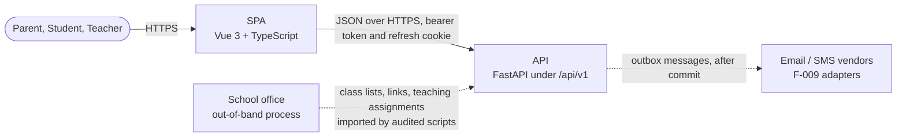
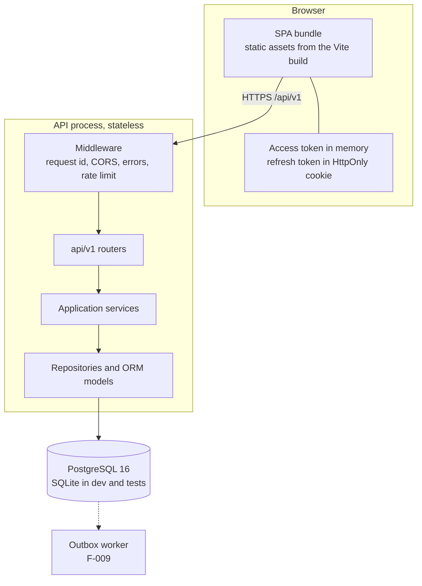
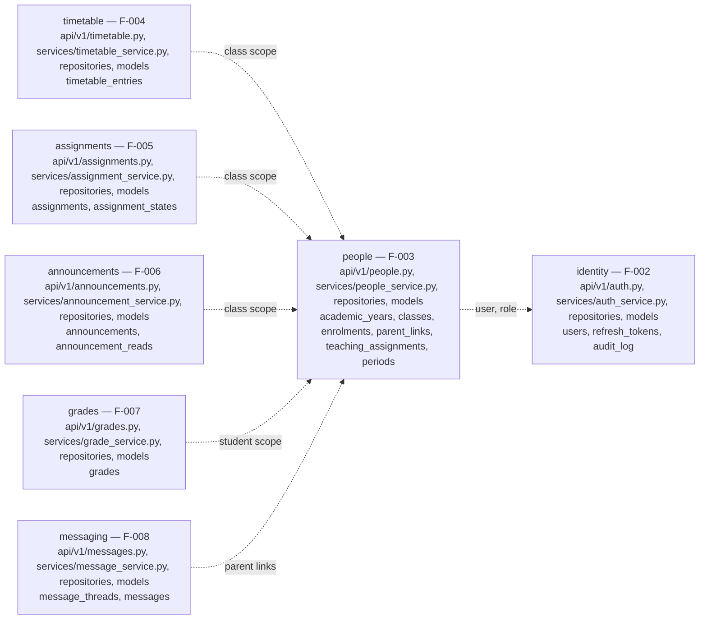
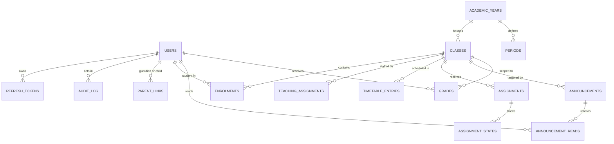
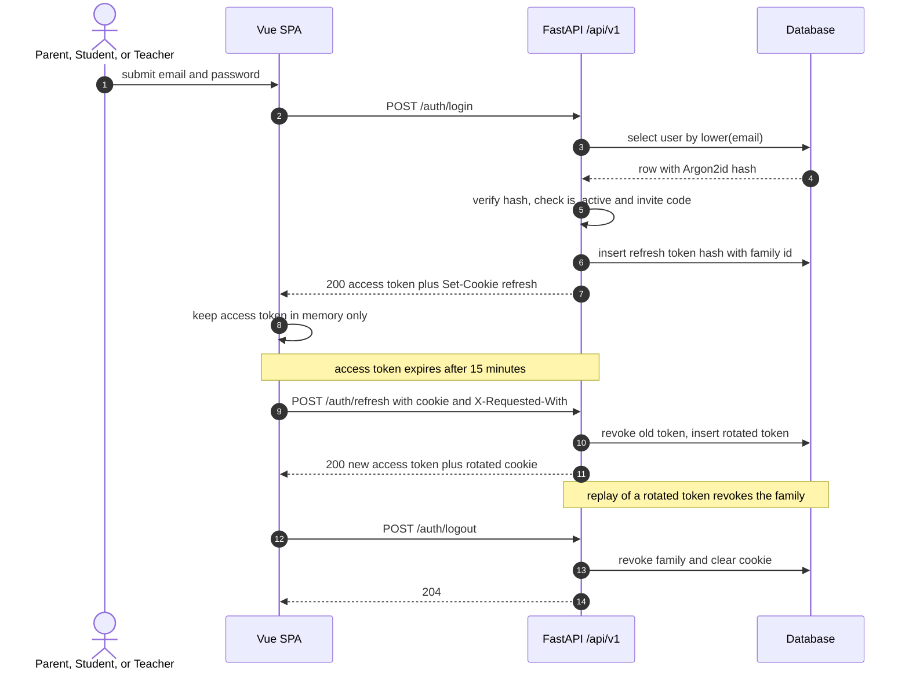
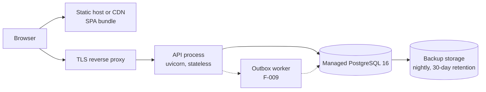

# Software Architecture Document — «مدرسه من» / My School

**Product:** «مدرسه من» / My School · **Document:** Software Architecture Document (C4-lite)<br/>**Version:** 2.0 — school-product baseline (supersedes the course-starter scheduling architecture) · **Date:** 2026-11-19 · **Status:** baseline; accepted ADRs override this document and approved feature SPECs override both.

## 1. Purpose and scope

«مدرسه من» is a modular monolith: one Vue 3 SPA, one FastAPI application, one relational database, divided into seven domain modules that never share tables. This document records the context, containers, module boundaries, layering, data model, session flow, deployment, and the decisions behind them. `AGENTS.md` §5 and the accepted ADRs are binding where this document is silent.

## 2. Architectural drivers and quality attributes

| Driver | Quality attribute | Architectural response |
|---|---|---|
| A parent must never see another family's child | Security, privacy | Relationship-scoped repositories, authorization inside services, security test per endpoint, identical responses for unknown and forbidden resources |
| Due dates and weeks must be unambiguous | Correctness of academic time | UTC persistence, a single `core/time.py`, Saturday-start weeks, DST-zone fixtures |
| A grade change must be explainable | Auditability | Append-only `audit_log` written in the same transaction as the change |
| One developer, course deadline, TDD | Maintainability, testability | Boring stack, explicit layers, SQLite fast tests, small migrations |
| Persian-first, RTL, accessible | Usability, accessibility | `fa` locale module, CSS logical properties, axe smoke checks in CI |

## 3. Technology baseline

| Concern | Choice |
|---|---|
| Frontend | Vue 3, TypeScript, Vite, Vue Router, Pinia, Tailwind CSS, Vazirmatn |
| Backend | FastAPI, Pydantic v2, SQLAlchemy 2.x typed mappings, Alembic |
| Toolchain | `uv` (backend) and `pnpm` (frontend) from lockfiles; Python 3.12+, Node 20+ |
| Databases | SQLite via `aiosqlite` locally and in fast tests; PostgreSQL 16 in CI and production |
| Tests | pytest, Vitest + Vue Test Utils + MSW, Playwright, axe |
| Contract | OpenAPI 3.1 generated by FastAPI and reviewed in CI |
| CI | GitHub Actions: lint, type check, tests, build, PostgreSQL migration run, outbox worker from F-009 |

## 4. System structure

### 4.1 System context



### 4.2 Container view



Only the browser holds session state, so any API instance can serve any request and instances can be replaced without draining.

### 4.3 Component view per domain module

Each module follows the same shape — router (`api/v1`), application service (use cases and transaction boundaries), repositories (SQL against its own tables), and ORM models — and the labels below list the planned files and owned tables.



## 5. Module boundaries and dependency rules

| Module | May depend on | Owns tables |
|---|---|---|
| identity | core only | `users`, `refresh_tokens`, `audit_log` |
| people | identity, core | `academic_years`, `classes`, `enrolments`, `parent_links`, `teaching_assignments`, `periods` |
| timetable | people, core | `timetable_entries` |
| assignments | people, core | `assignments`, `assignment_states` |
| announcements | identity, people, core | `announcements`, `announcement_reads` |
| grades | identity, people, core | `grades` |
| messaging | identity, people, core | `message_threads`, `messages` |

1. **Modules never read or write each other's tables.** A module that needs another module's data calls its service interface; SQL outside the owning repository is rejected in review, and foreign keys may cross boundaries only for referential integrity.
2. No module imports another module's router or request/response schemas; shared shapes live in service DTOs or `core`.
3. Direction is one-way: identity → core; people → identity; timetable, assignments, announcements, grades → people; messaging → identity and people.
4. No module depends on a later-phase module, and cycles are never acceptable, including through `core`; `core` holds no domain knowledge.

## 6. Backend layering and layout

| Layer | Location | May import | Must not do |
|---|---|---|---|
| HTTP | `app/api/v1/` | services, schemas, deps | Hold business rules, touch the ORM directly |
| Application | `app/services/` | repositories, domain, core | Build responses, parse HTTP |
| Domain | `app/domain/` | core only | Perform I/O or reference SQLAlchemy |
| Persistence | `app/repositories/`, `app/models/` | models, core, session | Decide authorization or status codes |
| Infrastructure | `app/core/`, `app/db/` | third-party libraries | Contain domain rules |

One session per request, one transaction per use case, session closed in a dependency finalizer; network calls never run inside a transaction.

```text
apps/api/app/
├── main.py            app factory, middleware, router registration
├── api/v1/            auth.py, health.py, deps.py (session, current user, role guards)
├── services/          use cases and transaction boundaries (auth_service.py)
├── domain/            pure rules (password_policy.py)
├── repositories/      one file per aggregate (user.py, refresh_token.py)
├── models/            SQLAlchemy 2.x mappings (user.py, refresh_token.py, audit_log.py)
├── schemas/           Pydantic v2 request and response models (auth.py)
├── core/              config, security, errors, logging, rate_limit, time
└── db/                engine, session factory, declarative base
```

Grouping is by layer while identity is the only implemented module; ownership is carried by file naming and §5. A module that outgrows one file per layer becomes a package under `app/modules/<module>/`, an internal refactor that must not change the dependency direction.

## 7. Frontend architecture

```text
apps/web/src/
├── main.ts, App.vue          mount, shell, RTL document setup
├── router/                   route table and guards
├── modules/auth/             views, components, api, store, validation
├── modules/                  dashboard, timetable, assignments, announcements, grades
├── shared/api/http.ts        fetch wrapper, bearer injection, single-flight refresh
├── shared/i18n/fa.ts         every user-facing Persian string
├── shared/                   components, composables, date and number formatting
└── styles/tokens.css         Tailwind theme tokens
```

- **Pinia stores:** `auth` holds the in-memory access token, the current user, and status. Content modules keep narrow per-view caches (for example one week of timetable) with explicit invalidation; server state is not mirrored globally.
- **`shared/api/http.ts`:** prefixes `/api/v1`, sends credentials and `X-Requested-With`, attaches the bearer token, maps `application/problem+json` to a typed error, and on `401` performs one shared refresh promise before retrying once — parallel failures await the same promise.
- **Router guards:** `requiresAuth`, `guestOnly`, `requiresRole`, preserving `?redirect=`. Guards are UX only; the backend remains the authorization boundary.
- **i18n and RTL:** all strings come from `shared/i18n/fa.ts` through typed keys with no Persian literal inside a component; timestamps render in the school timezone and Persian calendar; `<html dir="rtl" lang="fa">`, Vazirmatn, CSS logical properties (`margin-inline`, `padding-block`) instead of left/right utilities, and `dir="ltr"` isolation for emails, invite codes, and numeric identifiers.

## 8. Data model overview

F-002 introduces `users`, `refresh_tokens`, and `audit_log`. F-003 adds `academic_years`, `classes`, `enrolments`, `parent_links`, `teaching_assignments`, and `periods`; F-004 and F-005 add `timetable_entries`, `assignments`, and `assignment_states`; F-006 and F-007 add `announcements` with `announcement_reads`, and `grades`; F-008 and F-009 add `message_threads`, `messages`, and `outbox_messages`.



Identifiers are UUIDs stored as `CHAR(36)` for engine parity; timestamps are timezone-free UTC values generated in Python; `parent_links` carries guardian and child foreign keys plus a relationship type; `grades` stores value, scale, weight, publish state, and author; `audit_log` is append-only and never updated or deleted by the application.

## 9. Authentication sequence



The SPA never persists the access token; a reload recovers the session through a single silent refresh, which requires `credentials: include` on the refresh and logout calls.

## 10. Persistence and migrations

- Alembic owns the schema; one migration per feature, named `000N_<module>` (for example `0001_identity`), with a tested downgrade. The application never calls `create_all()` outside test fixtures; tests build the schema from migrations so parity is exercised.
- Portability rules from ADR-0002: no `citext`, no PostgreSQL-only server defaults in models, expression indexes both engines accept, Python-generated UTC timestamps.
- SQLite enforces foreign keys on every connection; tests configure the engine and pool explicitly to avoid in-memory surprises.
- CI runs the full migration chain against PostgreSQL 16 and the integration suite on top of it; a released migration is never edited — corrections arrive as a new migration.

## 11. Cross-cutting concerns

Every error is `application/problem+json` with a stable machine code; the request id travels in `X-Request-ID` rather than the body, so the shape is identical across routes:

```json
{
  "type": "https://myschool.local/errors/email-already-registered",
  "title": "Email already registered",
  "status": 409,
  "code": "email_already_registered",
  "detail": "این ایمیل قبلاً ثبت شده است.",
  "errors": [{ "field": "email", "message": "قبلاً استفاده شده است." }]
}
```

- **Logging and health:** middleware assigns a request id, echoes it in the response header, and writes structured JSON with route, status, and latency; bodies, tokens, emails, grades, and children's names are never logged. `GET /api/v1/health` returns status, version, and database connectivity without leaking internals.
- **Configuration:** `pydantic-settings` loads `APP_ENV`, `DATABASE_URL`, `JWT_SECRET`, token lifetimes, `TEACHER_INVITE_CODE`, `CORS_ORIGINS`, and `SCHOOL_TIMEZONE`; startup fails fast on a missing value and production rejects a JWT secret under 32 bytes.
- **Rate limiting:** a per-process token bucket with the limits in SRS NFR-SEC-005; each instance counts separately, so a shared store is required before horizontal scaling (tracked in F-010).
- **Time:** all conversions go through `core/time.py` (school timezone, week boundaries, local-date-to-UTC helpers); no other module imports `zoneinfo`.

## 12. Deployment view



| Environment | Frontend | Backend | Database | Purpose |
|---|---|---|---|---|
| Local dev | Vite dev server with proxy | uvicorn `--reload` | SQLite file | Fast feedback with seeded demo data |
| CI | Production build | pytest against the ASGI app | SQLite plus a PostgreSQL 16 service | Gates and migration validation |
| Production | Static hosting over HTTPS | One or more API instances | Managed PostgreSQL 16 | Single-school deployment |

Deployment order is backend first (migration before start), then the static bundle; rollback reverts the bundle and, where practical, downgrades the migration, accepting that sessions are invalidated by design.

## 13. Architecture decision index

| ADR | Decision | Status | Referenced by |
|---|---|---|---|
| [ADR-0001](adr/0001-modular-monolith.md) | Modular monolith with Vue SPA and FastAPI API | Accepted | Whole system |
| [ADR-0002](adr/0002-database-environments.md) | SQLite for development, PostgreSQL for production and CI | Accepted | §10 |
| [ADR-0003](adr/0003-authentication-session-strategy.md) | In-memory access JWT plus rotating HttpOnly refresh token | Accepted | §9, §11 |
| [ADR-0004](adr/0004-academic-time-model.md) | UTC instants, `Asia/Tehran` calendar rules, one time module | Accepted | §11, SRS §6 |
| [ADR-0005](adr/0005-role-model-and-teacher-onboarding.md) | Single immutable role, teacher onboarding by invite code | Accepted | §4.3, §5 |

Still required before the relevant phase: outbox and worker strategy (F-009), administrator-role decision if SRS §11 resolves toward an admin console, and a shared rate-limit store before multi-instance deployment.

## 14. Out of scope and future evolution

- **Microservices and per-module deployables** — revisited only if a module needs an independent release cadence; the current boundaries already allow extraction.
- **Realtime transport** (websockets, push) — screens refresh on navigation; realtime needs its own ADR.
- **Native mobile applications** — the responsive RTL SPA is the only client this release.
- **Event sourcing, CQRS, message brokers** — the outbox table covers the single asynchronous need.
- **Multi-tenancy, caching tiers, read replicas, and file storage** — one school per deployment, and no measured need at the assumed scale (SRS C-008).
